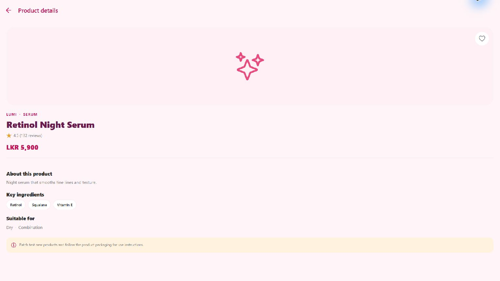
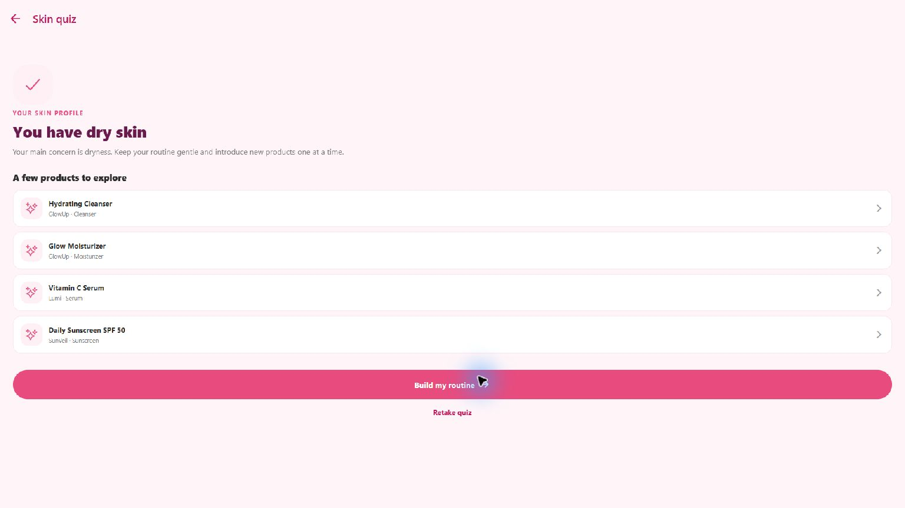
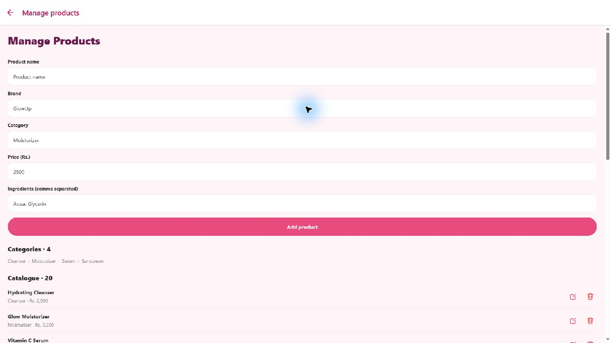
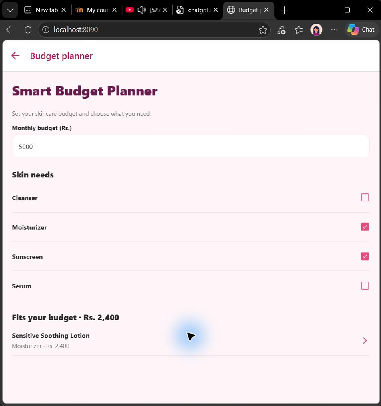
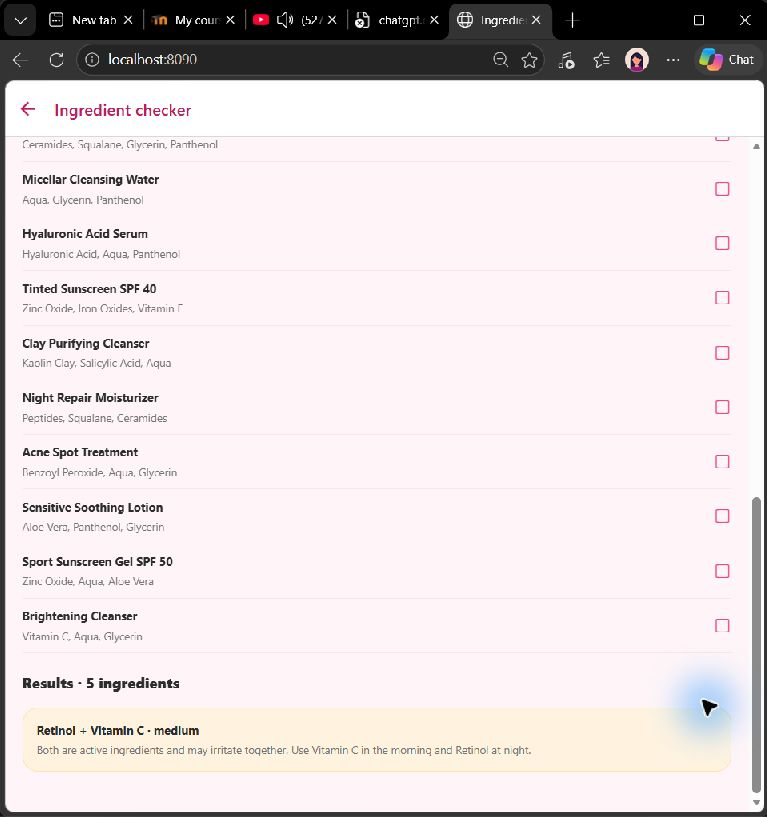
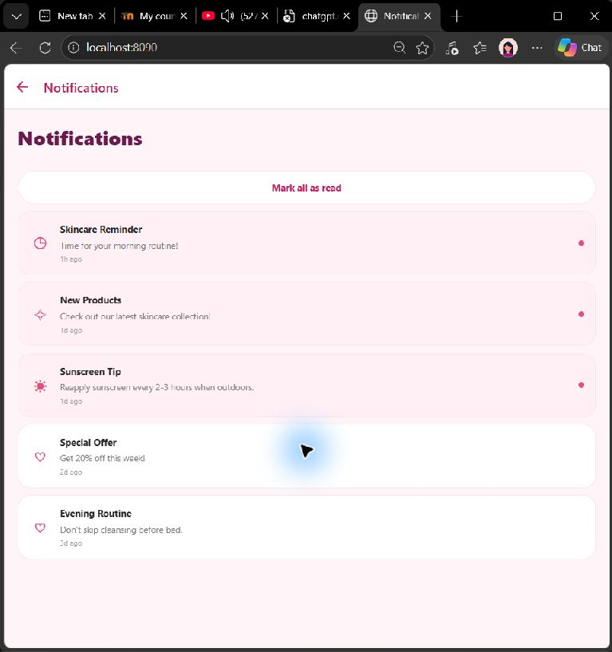
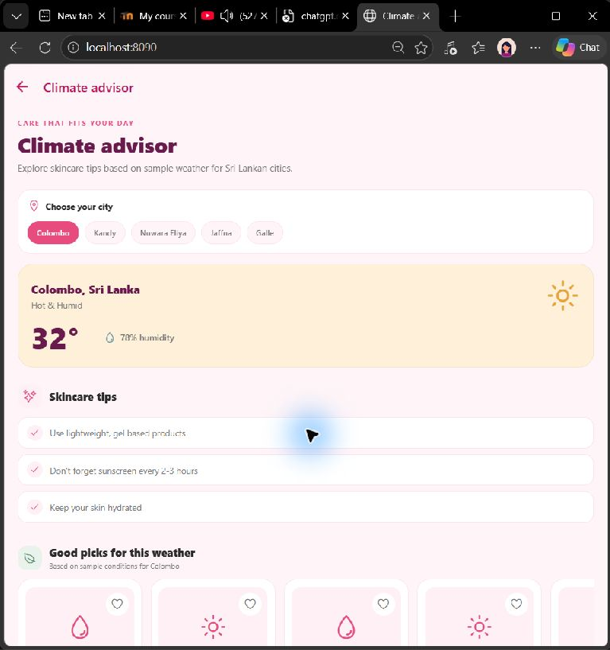

# GlowUp — Smart Skincare Companion

GlowUp is an Expo and React Native skincare companion designed to help people browse skincare products, understand common ingredient conflicts, and plan simple daily routines.

## Project objective

Bring product discovery, skin guidance, and routine planning together in one friendly, offline-first app. The current project is a local showcase prototype: app data is saved on the current device or browser.

## Key features

- Splash, local demo registration, login, and password-reset request screens
- Product catalogue with search and category filters, product details, favourites, and product comparison
- Skin-type quiz and morning/evening routine planner
- Climate advisor with sample weather conditions for Sri Lankan cities
- Profile settings and locally saved notifications
- Budget planner that suggests products within a chosen budget
- Ingredient checker that flags combinations from the bundled conflict list
- Admin dashboard and local product add, edit, and delete controls
- Local persistence for profile session, products, notifications, favourites, and routines

## Application screenshots

These screenshots were captured from the running Expo web app using the local demo profile.

| Splash and home | Product discovery | Product details |
| --- | --- | --- |
|  |  |  |

| Catalogue search and filter | Favourites | Product comparison |
| --- | --- | --- |
|  |  |  |

| Skin quiz results | Personal routine | Admin product management |
| --- | --- | --- |
|  |  |  |

| Budget planner | Ingredient checker |
| --- | --- |
|  |  |

| Notifications | Climate advisor |
| --- | --- |
|  |  |

## Technologies

- React Native 0.76 and React 18
- Expo SDK 52 with Expo Web
- React Navigation (bottom tabs and native stack)
- AsyncStorage for device/browser-local persistence
- Expo Vector Icons and Expo Linear Gradient
- JavaScript and JSON bundled product, climate, notification, and ingredient data

## Project structure

```text
.
├── App.js                       # App providers and navigation container
├── app.json                     # Expo application configuration
├── assets/                      # App image and icon assets
├── src/
│   ├── components/              # Shared UI elements and product cards
│   ├── context/                 # Product and favourites state
│   ├── data/                    # Bundled products and guidance data
│   ├── navigation/              # Tab and stack navigation
│   ├── screens/                 # Authentication, user, and admin screens
│   ├── services/                # Local storage helpers
│   └── theme/                   # Colors and typography
├── docs/
│   └── screenshots/             # Screenshots captured from the running web app
├── package.json                 # Dependencies and Expo scripts
└── README.md
```

## Installation and setup

Requirements: Node.js (LTS) and npm.

```sh
npm ci
npm run web
```

Expo starts the app in a browser. Open the URL printed in the terminal; it is usually [http://localhost:8081](http://localhost:8081). Keep the Expo terminal running while using the app. If the port is busy, Expo may choose another port and print that address.

To create a static web build:

```sh
npx expo export --platform web
```

The generated static site is written to `dist/`.

## Branches and commits

`main` contains the showcase-ready project. `develop` is the integration branch. `feature/project-setup` and `feature/local-data` preserve the project setup and local-storage feature work. New improvements can be developed in a `codex/` or `feature/` branch and merged into `develop` before updating `main`.

## Important prototype details

- Login and registration store a local demo session. There is no server authentication, password storage, or email delivery for password resets.
- Climate conditions are sample data, not a live weather service.
- Product administration is local showcase functionality and has no protected admin role or remote database.
- Ingredient conflict guidance covers only the pairs in `src/data/ingredientConflicts.json`; it is not a substitute for product labels or professional advice.
