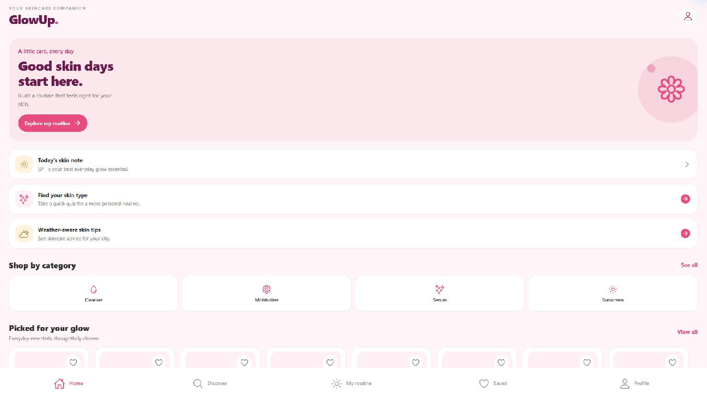
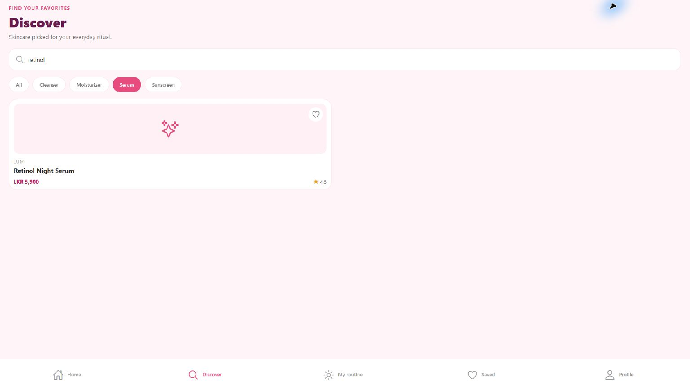
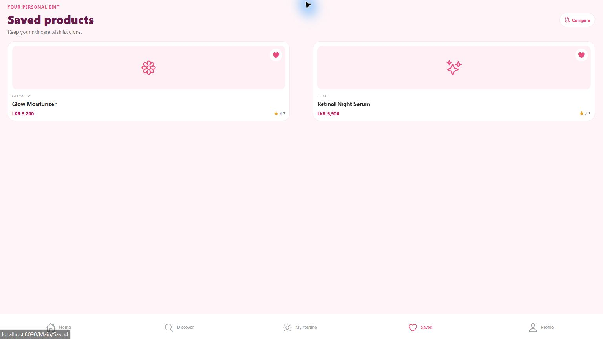
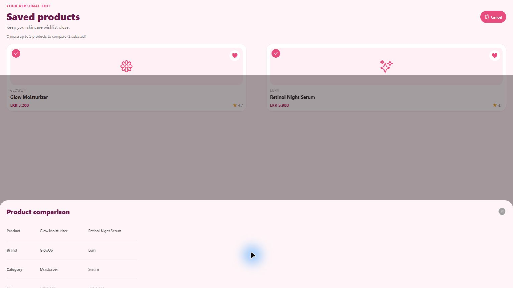
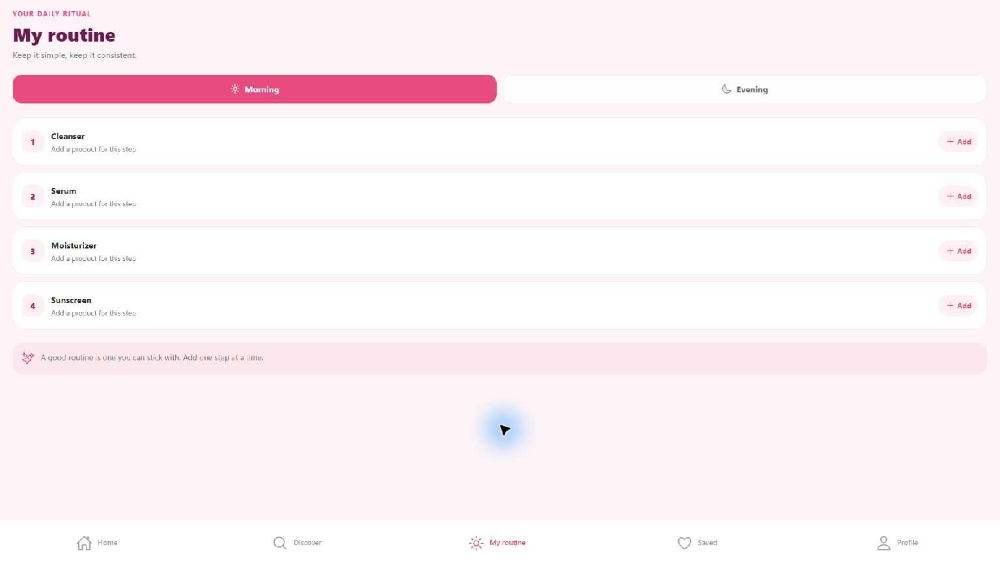

# GlowUp — Smart Skincare Companion

GlowUp is a skincare companion app built with React Native and Expo. It brings product discovery, simple skin guidance, and routine planning into a single mobile-friendly experience. The web build can be run locally in a browser.

## Project objective

Help users explore skincare products and organize a routine using product, ingredient, and sample climate information. This is a local prototype: it does not require a remote service, and its data is stored on the current device or browser.

## Key features

- **Account screens:** splash screen, local demo registration and login, and a password-reset request flow
- **Product discovery:** searchable catalogue, category filters, product details, favourites, and product comparison
- **Personal care:** skin-type and concern quiz, plus a morning and evening routine planner
- **Planning tools:** budget-based product suggestions and an ingredient checker for common combinations
- **Climate advisor:** skincare tips and product suggestions for sample conditions in Sri Lankan cities
- **Profile and notifications:** editable local profile and skincare reminders
- **Product administration:** local dashboard and add, edit, and delete controls for products and categories
- **Local persistence:** profile, products, notifications, favourites, and routines persist in browser/device storage

## Application screenshots

These screenshots were captured from the running Expo web app and show the implemented application screens.

| Splash and home | Product discovery | Product details |
| --- | --- | --- |
|  |  |  |

| Catalogue search and filter | Favourites | Product comparison |
| --- | --- | --- |
|  |  |  |

| Skin quiz results | Personal routine | Admin product management |
| --- | --- | --- |
|  |  |  |

| Budget planner | Ingredient checker |
| --- | --- |
|  |  |

| Notifications | Climate advisor |
| --- | --- |
|  |  |

## Technologies

- React 18.3 and React Native 0.76
- Expo SDK 52 and Expo Web
- React Navigation 7 (bottom tabs and native stack)
- AsyncStorage for device/browser-local persistence
- Expo Vector Icons, Expo Linear Gradient, and Safe Area Context
- JavaScript and JSON bundled product, climate, notification, and ingredient data

## Project structure

```text
.
├── App.js                       # App entry point and providers
├── app.json                     # Expo application configuration
├── babel.config.js              # Babel configuration
├── docs/
│   └── screenshots/             # Screenshots captured from the running web app
├── src/
│   ├── components/              # Shared UI, buttons, inputs, and product cards
│   ├── context/                 # Product and favourites state
│   ├── data/                    # Bundled products and guidance data
│   ├── navigation/              # Tab and stack navigation
│   ├── screens/                 # Account, product, quiz, routine, climate, and admin screens
│   ├── services/                # Local storage helpers
│   └── theme/                   # Colors and typography
├── package.json                 # Dependencies and npm scripts
├── package-lock.json            # Locked dependency versions for npm ci
└── README.md
```

## Installation and setup

Requirements: Node.js (LTS) and npm.

```sh
npm ci
npm run web
```

Expo starts the web app and prints its local URL in the terminal. Open that URL in a browser and keep the Expo process running while using the app. Expo may choose a different port if its default port is busy.

To create a static web build:

```sh
npx expo export --platform web
```

The generated static site is written to `dist/`, which is ignored by Git.

## Branches and commits

The repository maintains `main` and `develop`, along with `feature/project-setup` and `feature/local-data` branches. Use feature branches for scoped work, then integrate changes into the project branches.

## Important prototype details

- Login and registration store a local demo session. There is no server authentication, password storage, or email delivery for password resets.
- Product, profile, favourite, routine, and notification changes are stored locally and are not shared across devices.
- Climate conditions are sample data, not a live weather service.
- Product administration is local functionality and has no protected admin role or remote database.
- Ingredient conflict guidance covers only the combinations listed in `src/data/ingredientConflicts.json`. It is general information and not medical advice.
